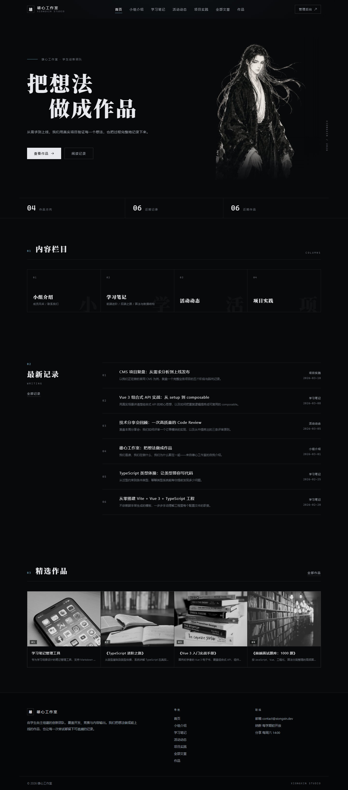
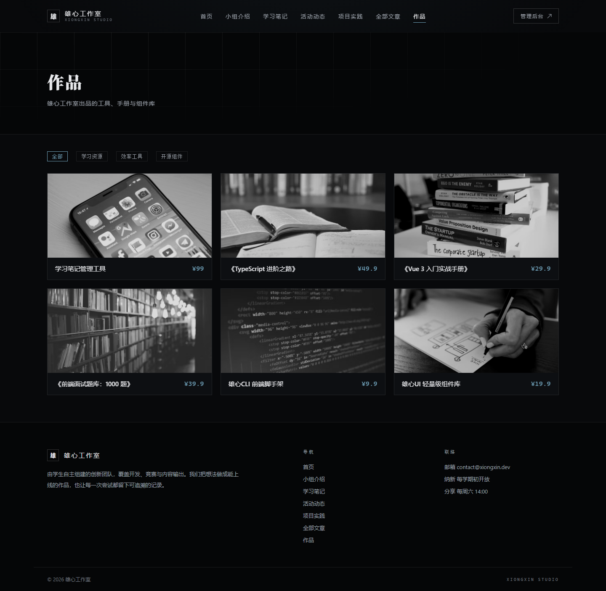
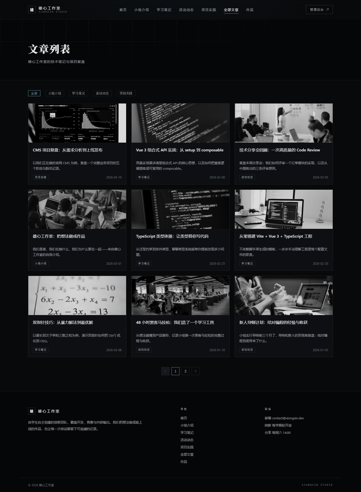
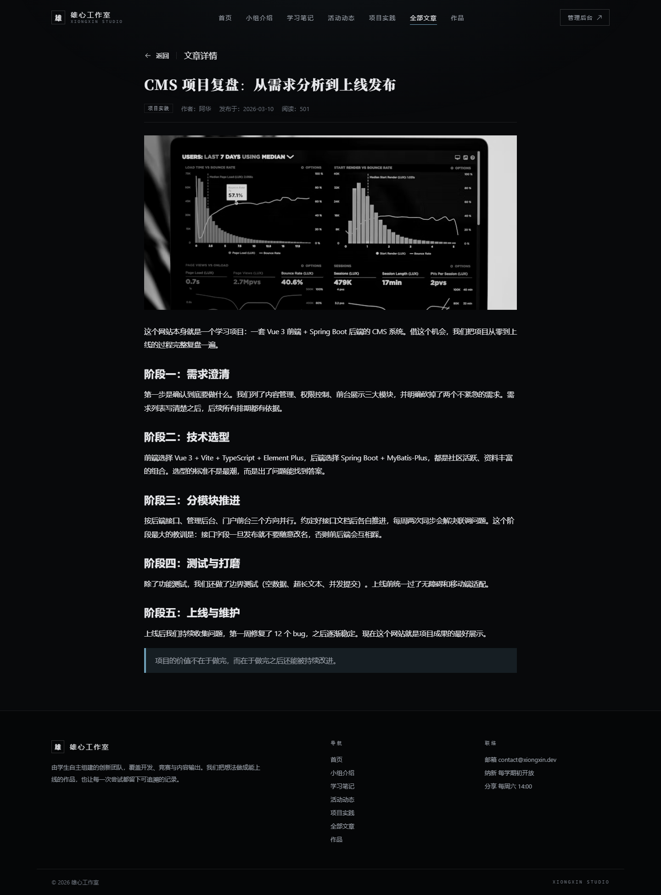
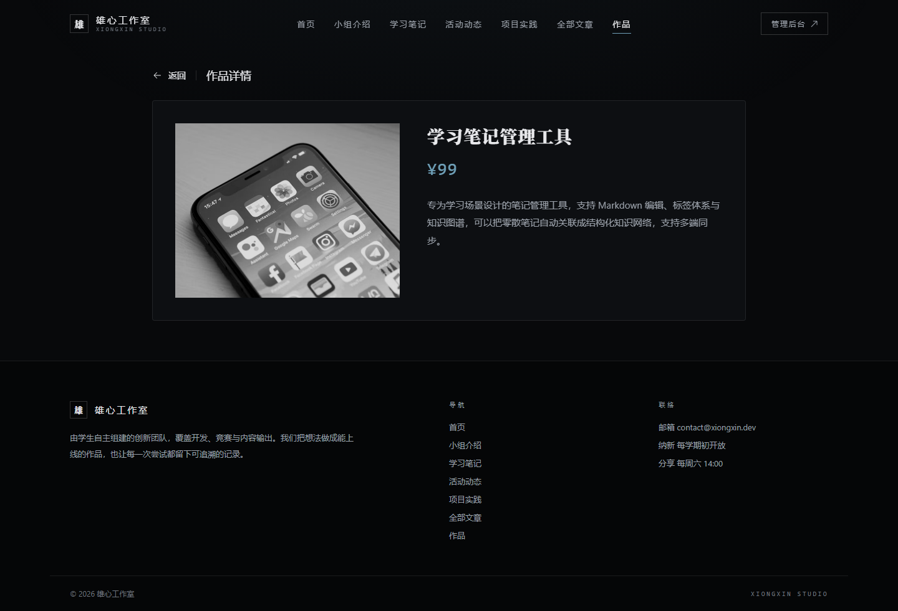

<div align="center">

# Backend Journey

### Java 后端个人技术作品集


---

一个已交付项目 + 三个规划中项目，一套面向公开审查的 Java 后端作品集。

工程标准见 [.cursor/rules/core.mdc](.cursor/rules/core.mdc)：安全基线、交付门禁、文档举证不因"学习项目"豁免；学习导航作为附加价值保留。

> 🎯 **前后端配套学习**：每个后端项目都有对应的 Vue 3 前端实现（一个后端可能对应「管理后台 + 前台门户」多个应用），前后端联动，完整还原真实项目开发流程。前端仓库见文末「[配套前端项目](#配套前端项目)」。

</div>

---

## 项目路线

四个项目按业务类型递进，当前完成第一个，其余按计划推进；每个项目自包含，可独立参考和部署。

| 项目 | 业务类型 | 状态 | 学习重点 |
|------|---------|------|---------|
| [bj-01-cms](./bj-01-cms/) | 企业官网 + CMS | ✅ 已完成 | Java 语法、Spring Boot 入门、分层架构 |
| bj-02-ecommerce | B2C 电商 | ⬜ 待开始 | 缓存/安全/事务、设计模式、第三方集成 |
| bj-03-community | 社区/论坛 | ⬜ 待开始 | 社交/消息队列、Feed 流设计、异步解耦 |
| bj-04-saas | SaaS 工作台 | ⬜ 待开始 | 多租户架构、Docker 部署、完整 RBAC |

---

## 技术栈

| 类别 | 技术 |
|------|------|
| **语言** | Java 17 |
| **框架** | Spring Boot 3.2+, MyBatis-Plus 3.5+ |
| **数据库** | MySQL 8.0, Flyway 9.22 |
| **缓存/搜索** | Redis, Elasticsearch（后续项目引入） |
| **文档/测试** | SpringDoc OpenAPI, JUnit 5, Mockito, AssertJ |
| **构建** | Maven 3.9+ |

---

## 仓库结构

```
backend-journey/
├── bj-01-cms/              # 项目一：企业官网 + CMS（已完成）
├── bj-02-ecommerce/        # 项目二：电商系统（待创建）
├── bj-03-community/        # 项目三：社区/论坛（待创建）
├── bj-04-saas/             # 项目四：SaaS 工作台（待创建）
├── docs/ai-context/        # AI 专属区：进度追踪/知识地图/项目路线图
├── docs/standards/         # 工程规范：版本演进/Flyway/CHANGELOG
├── docs/learning/          # Java 语法学习导航（零基础 → 能看代码）
├── docs/cheatsheet/        # 跨项目速查卡片
├── docs/testing/           # 测试经验沉淀（原则→工具→实战→排查→协作，5 组 10 篇）
├── docs/coverage/          # 测试报告（AI 生成）
├── docs/tools/             # 工具配置
├── .cursor/rules/          # Cursor AI 规则（7 条，核心入口 core.mdc）
├── .gitattributes          # 统一仓库行尾为 LF
├── .gitignore
├── AGENTS.md               # Cursor 代理说明
├── CHANGELOG.md            # 版本变更记录
└── README.md               # 本文件
```

---

## 设计原则

1. **多项目自包含** — 每个项目独立 Spring Boot 工程，不共享代码模块，可单独参考和部署
2. **专业作品标准** — 面向公开审查，铁律/安全基线/交付门禁不因"学习项目"豁免
3. **通用用库，业务手写** — 鉴权/工具/Excel 用成熟库，业务建模与核心流程自己写
4. **业务驱动** — 按业务类型（内容型 → 交易型 → 社交型）递进，不是技术点堆砌
5. **分层架构** — controller → service → mapper，各层职责分明
6. **测试同步** — 核心 Service 与公共组件必须配套单测，变更端点必须冒烟
7. **统一返回** — 所有接口返回 `R` 对象（code + msg + data），API 边界不出现 Entity/Map
8. **文档举证** — 文档中的每个 ✅ 必须有代码、测试或运行结果佐证

---

## 配套前端项目

每个后端项目都有对应的前端实现，使用 Vue 3 + Vite + TypeScript，与后端接口真实联调。一个后端项目可能对应多个前端应用（管理后台 + 前台门户）：

| 后端项目 | 前端应用 |
|---------|---------|
| bj-01-cms | [pj-01-cms-admin（管理后台）](https://github.com/readant/frontend-journey/tree/project/cms-frontend)、[pj-01-cms-portal（前台门户）](https://github.com/readant/frontend-journey/tree/project/cms-frontend) |
| bj-02-ecommerce | pj-02-ecommerce-frontend（待创建） |
| bj-03-community | pj-03-community-frontend（待创建） |
| bj-04-saas | pj-04-saas-frontend（待创建） |

> 前端学习同样遵循「项目驱动」路线，按业务类型递进，可与本仓库各后端项目一一对应。

### bj-01-cms 界面预览

前台门户（pj-01-cms-portal）的真实运行截图，页面数据均来自本仓库 bj-01-cms 的后端接口：

| 首页 | 作品列表 |
| :---: | :---: |
|  |  |

| 全部文章 | 文章详情 |
| :---: | :---: |
|  |  |

| 作品详情 |
| :---: |
|  |

---

## 仓库地址

本仓库同时托管在 GitHub 与 Gitee，内容保持同步：

- **GitHub**（主仓库）：https://github.com/readant/backend-journey
- **Gitee**（镜像）：https://gitee.com/readant/backend-journey

> 国内访问 Gitee 速度更快。两个仓库由同一份 Git 历史推送，不存在内容差异。

---

## 快速开始

### 1. 准备数据库

只需本机装有 MySQL 8.x，**库和表都不用手工创建** —— Flyway 会在应用启动时自动建表并灌入演示数据。

```sql
CREATE DATABASE IF NOT EXISTS bj_cms DEFAULT CHARACTER SET utf8mb4 COLLATE utf8mb4_general_ci;
```

### 2. 注入数据库口令

口令通过环境变量 `DB_PASSWORD` 注入，仓库内不保存任何真实凭据（见 `.cursor/rules/security.mdc`）。

```bash
# 方式一：临时设置，仅当前终端会话有效
export DB_PASSWORD=你的本地MySQL密码        # Windows PowerShell: $env:DB_PASSWORD="你的密码"
                                           # Windows cmd:        set DB_PASSWORD=你的密码

# 方式二：用户级环境变量，一次设置后 IDE 与所有终端长期生效（设置后需重开 IDE）
setx DB_PASSWORD "你的本地MySQL密码"
```

```text
方式三：复制 .env.example 为 .env，由 VS Code 的 launch.json 自动读取；
       使用 IDEA 时请在「运行配置 → Environment variables」中填写 DB_PASSWORD。
```

连接地址与用户名带有默认值（`localhost:3306/bj_cms`、`root`），需要覆盖时用同名环境变量 `DB_URL`、`DB_USERNAME`。

> 若启动时报 `Access denied for user 'root'@'localhost'`，通常意味着 `DB_PASSWORD` 没有生效（应用以**空口令**连接）。请确认变量已设置，且设置后已重开终端或 IDE —— 环境变量的修改不会影响已经启动的进程。

### 3. 编译与启动

```bash
git clone https://github.com/readant/backend-journey.git
cd backend-journey/bj-01-cms

mvn compile     # 编译
mvn test        # 全量测试
mvn spring-boot:run
```

```text
访问 API 文档：http://localhost:8080/swagger-ui/index.html
健康检查：    http://localhost:8080/api/v1/health
```

> 管理接口需要请求头 `Authorization: Bearer <登录返回的token>`。登录接口与 `/api/v1/site/**` 前台接口无需鉴权。

---

## Git 提交规范

采用 Conventional Commits + GitHub Flow 分支模型，按阶段和功能拆分提交：

```
<type>(<scope>): <description>
```

**分支规范（强制）**：禁止直接在 `main` 提交。所有改动先从 `main` 拉出分支，用 `--no-ff` 合回后删除：

```bash
git checkout main && git pull
git checkout -b feature/xxx        # 或 fix/xxx、docs/xxx
# ...开发并拆分提交...
git checkout main
git merge --no-ff feature/xxx -m "Merge branch 'feature/xxx' into main"
git push origin main
git branch -d feature/xxx
```

示例：

```
feat(phase1): 骨架搭建 - Maven + Spring Boot + 公共基础 + Health API
feat(phase2): 管理员与权限 - CRUD + BCrypt登录 + RBAC角色权限
docs: 更新项目 README 和速查卡片
```

---

## 学习进度

- **零基础入门**：先走 [Java 语法学习导航](docs/learning/README.md)（语法层），再看实战代码
- **进度追踪**：详见 [知识地图](docs/ai-context/knowledge-map.md) 和 [速查卡片](docs/cheatsheet/INDEX.md)

---

<div align="center">

学无止境，一起努力。如果觉得有帮助，点个 Star 鼓励一下吧 :)

_Last updated: 2026-08-14_

</div>